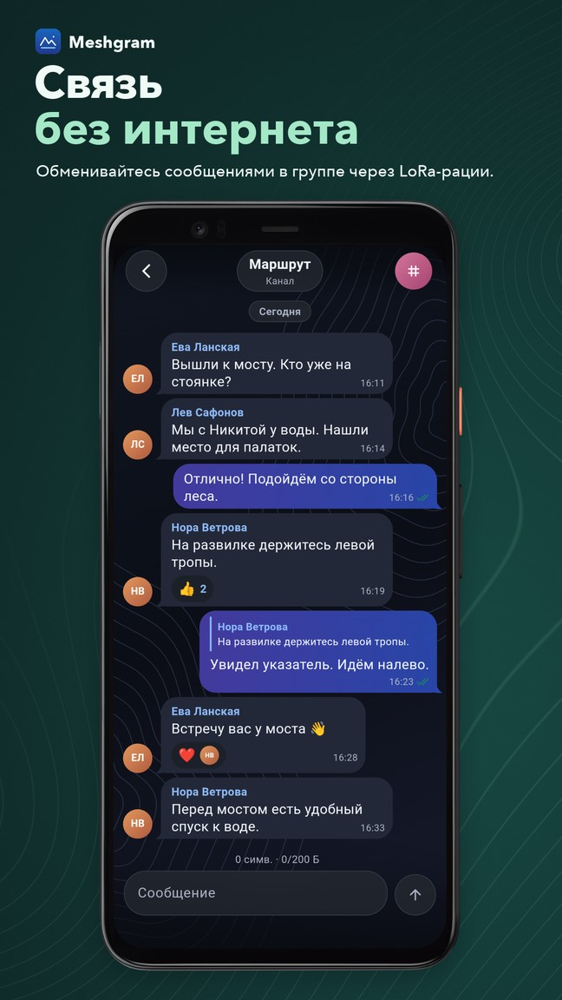
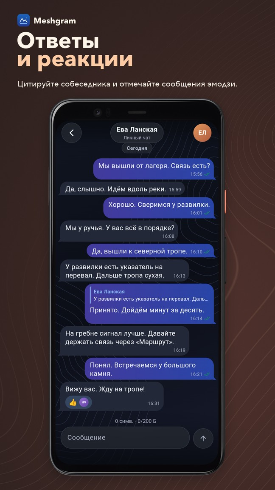
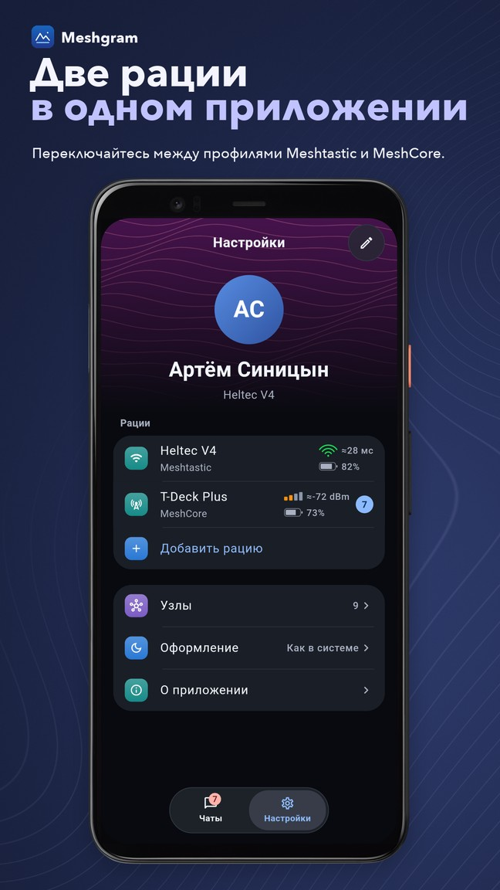

# Meshgram

Мессенджер для Android и iPhone, который передаёт сообщения через LoRa-рации с прошивкой **Meshtastic** или **MeshCore**. Подключите телефон к совместимой рации по Bluetooth или по локальной сети Wi-Fi. Интернет для переписки не нужен. Участники должны находиться в зоне связи одной совместимой радиосети.

<p align="center">
  
  
  
</p>

## На связи

- **В походной группе.** Пишите в общий канал, переходите в личный чат с участником и получайте локальные уведомления. Для каждого чата можно выключить звук.
- **С несколькими рациями.** Держите несколько подключений одновременно и переключайтесь между профилями. У каждой рации свои чаты, черновики и счётчик непрочитанных сообщений.
- **В пределах радиосети.** Откройте профиль узла, чтобы узнать, когда он выходил на связь, посмотреть полученные координаты и историю проверки маршрута. Набор сведений и действий зависит от прошивки.
- **В переписке.** Отвечайте на конкретное сообщение и переходите из цитаты к оригиналу. Доступность реакций зависит от протокола и данных сообщения.

Meshgram — независимый клиент. Профили Meshtastic и MeshCore можно использовать рядом, каждый в своей радиосети.

## Установка готовой сборки

Откройте последний релиз и разверните **Assets**. Для Android скачайте файл с расширением **.apk** прямо на телефон. Для iPhone скачайте **.ipa** на компьютер, с которого будете его подписывать. [Скачать Meshgram](https://github.com/Rusik636/Meshgram/releases/latest)

<a name="android-apk"></a>

### Android — установка APK

1. На телефоне с **Android 7.0 или новее** откройте скачанный APK из папки «Загрузки».
2. Если Android запросит разрешение на установку, нажмите **Настройки**. На Android 8 и новее включите **Разрешить установку из этого источника** для приложения, которым открыли файл (браузера или файлового менеджера). На Android 7 включите **Настройки → Безопасность → Неизвестные источники**. [Справка Android](https://developer.android.com/distribute/marketing-tools/alternative-distribution#unknown-sources)
3. Вернитесь к файлу, нажмите **Установить**, затем **Открыть**. Если Meshgram уже установлен из предыдущего релиза, выберите **Обновить**. После установки разрешение для источника можно выключить.

<a name="ios-ipa"></a>

### iPhone — подпись IPA на Windows или macOS

В релизе лежит **неподписанный IPA для iOS 15 и новее**. Для установки на свой iPhone понадобятся бесплатный Apple Account, компьютер с интернетом и USB-кабель с передачей данных. Ниже используется Sideloadly — утилита, которая подписывает готовый IPA и сразу устанавливает его на устройство. [Скачать Sideloadly для Windows или macOS](https://sideloadly.io/)

**Подготовьте компьютер**

- **Windows.** Установите настольные версии iTunes и iCloud по ссылкам Apple в окне загрузки Sideloadly. Если они установлены из Microsoft Store, следуйте инструкции Sideloadly по замене этих версий. Установите Sideloadly для Windows, подключите разблокированный iPhone по USB, нажмите на телефоне **Доверять** и убедитесь, что он появился в iTunes.
- **macOS.** Скачайте Sideloadly для Mac, переместите его в «Программы» и запустите. Подключите разблокированный iPhone по USB. В Finder выберите iPhone в боковой панели и подтвердите доверие на Mac и телефоне, если появится запрос.

**Подпишите и установите Meshgram**

1. В Sideloadly выберите свой iPhone в списке **iDevice**. Перетащите скачанный файл Meshgram с расширением **.ipa** в окно программы.
2. В поле **Apple ID** укажите свой Apple Account и нажмите **Start**. Пройдите авторизацию и подтвердите двухфакторный вход, если появится запрос. Дождитесь сообщения **Done**. Значок Meshgram появится на iPhone.
3. Если iOS сообщает о ненадёжном разработчике, откройте **Настройки → Основные → VPN и управление устройством**, выберите свой Apple Account в разделе приложений разработчика и подтвердите доверие.
4. На **iOS 16 и новее** включите **Настройки → Конфиденциальность и безопасность → Режим разработчика**, если он ещё выключен. Подтвердите перезагрузку, разблокируйте iPhone и подтвердите включение. Откройте Meshgram.

**Как продлевать подпись.** С бесплатным аккаунтом приложение можно запускать **7 дней** после каждой подписи. Для продления повторите установку поверх Meshgram с тем же Apple Account и тем же идентификатором приложения (Bundle ID), чтобы сохранить локальную переписку. Можно включить автоматическое продление в Sideloadly. Для этого компьютер с работающим Sideloadly Daemon должен видеть iPhone по USB или через настроенную синхронизацию по Wi-Fi. [Справка Sideloadly о продлении и обновлении](https://sideloadly.io/faq)

## Запуск из исходников

Понадобятся Flutter **3.47.9**, совместимый Android SDK и JDK 17 для Android. Для iPhone понадобятся macOS, Xcode и настройка подписи для своего устройства.

```sh
git clone https://github.com/Rusik636/Meshgram.git
cd Meshgram/mobile
flutter pub get
flutter test
flutter run
```

Чтобы посмотреть интерфейс без рации, запустите приложение с демонстрационными данными.

```sh
flutter run --dart-define=MESHGRAME_PREVIEW=true
```

Для локальной сборки APK выполните `flutter build apk --release` из папки `mobile`. Текущая конфигурация Gradle использует отладочную подпись. Для публикации собственного выпуска настройте отдельную подпись. Фоновая доставка сообщений по Wi-Fi на iOS требует расширения Local Push и соответствующих разрешений Apple. [Инструкции по сборке и Local Push](mobile/README.md)

## Где искать код

| Каталог | Что внутри |
| --- | --- |
| [mobile/lib/ui](mobile/lib/ui) | Экраны чатов, профили и настройки раций |
| [mobile/lib/mesh](mobile/lib/mesh) | Модель сообщений, сессии раций и локальная история |
| [mobile/lib/radio](mobile/lib/radio) | Транспорты Bluetooth и Wi-Fi, адаптеры Meshtastic и MeshCore |
| [mobile/test](mobile/test) | Тесты протоколов, подключений и интерфейса |
| [design-system](design-system) | Цвета, типографика и генератор токенов интерфейса |

Для отчёта об ошибке укажите модель телефона, версию приложения, модель и прошивку рации, способ подключения и шаги для воспроизведения. [Обсуждение ошибок и предложений](https://github.com/Rusik636/Meshgram/issues)

## Лицензия

Авторский код Meshgram распространяется под **GNU AGPL версии 3**. При распространении форка или работы, включающей охраняемый авторским правом фрагмент кода, сохраните имя автора и адрес исходного проекта. Три строки для указания авторства приведены в [NOTICE](NOTICE). При расхождении формулировок этого дополнительного условия применяется его русская редакция. Изменения можно подписать и своим именем.

Получателям производной версии предоставляются права AGPL и соответствующий исходный код в порядке, предусмотренном лицензией. Если пользователи взаимодействуют с вашей изменённой версией по сети, предложите им бесплатно получить исходники этой версии. [Полный текст лицензии](LICENSE)

## Сторонние компоненты

У иллюстраций плат, шрифта Noto Color Emoji, каталога Unicode и зависимостей свои условия использования. [Перечень компонентов и лицензий](mobile/assets/about/third-party.json)

Bluetooth-транспорт использует FlutterBluePlus 2.3.15. Автор плагина устанавливает отдельные условия для коммерческого использования. Перед распространением сборки с этим плагином проверьте права на его включение и совместимость условий распространения. [Лицензия FlutterBluePlus](https://pub.dev/packages/flutter_blue_plus/versions/2.3.15/license)
